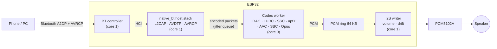

<div align="center">

# ESP32 Hi-Res Bluetooth Speaker: A2DP Sink with LDAC, LHDC V5, aptX HD, AAC and Samsung SSC

**Pure-playback Bluetooth audio receiver firmware for the original ESP32: A2DP sink + AVRCP + I2S DAC, with its own
Bluetooth host stack and decoders for LDAC, LHDC V5 (up to 192 kHz / 24-bit / 1000 kbps), aptX, aptX HD, AAC, SBC
(bitpool up to 250), Opus and Samsung Scalable/Seamless Codec.**

[](LICENSE)


[Highlights](#highlights) · [Codecs](#codecs) · [Hardware](#hardware) · [Build and flash](#build-and-flash) ·
[Performance](#performance) · [Windows PCs](#using-it-with-a-windows-pc) · [Design](#how-it-works) · [FAQ](#faq)

</div>

---

## Highlights

| | |
|---|---|
| **Every popular hi-res codec** | LDAC, LHDC V5, aptX, aptX HD, AAC, SBC, Opus and Samsung SSC on one ESP32 |
| **192 kHz / 24-bit** | LHDC V5 at 1000 kbps decodes in 3.2 ms per 5 ms frame on one core (64 %) |
| **Original ESP32, no PSRAM** | 4 MB flash, 520 KB SRAM; a codec's memory is allocated only while it plays |
| **Pure playback** | A2DP sink + AVRCP only: no BLE, no DSP, no sound effects; the decoder owns a whole core |
| **Own Bluetooth host stack** | Talks to Espressif's controller over HCI; no Bluedroid or NimBLE |
| **Glitch-free buffering** | 150 ms jitter buffer kept mostly compressed, clock-drift correction without a resampler |
| **Builds from this repo** | ESP-IDF 6.1 and all decoder libraries are bundled |

## Codecs

| Codec | Sample rates | Bit depth | Bitrate | Typical sources |
|---|---|---|---|---|
| **LHDC V5** | 44.1 / 48 / 96 / **192 kHz** | 16 / 24-bit | up to 1000 kbps | Xiaomi, nubia/RedMagic, OnePlus, OPPO |
| **LDAC** | 44.1 / 48 / 88.2 / 96 kHz | 16 / 24 / 32-bit | 330 / 660 / 990 kbps | Android phones, Windows with a third-party driver |
| **Samsung SSC** | 44.1 / 48 / 96 kHz | 16 / 24-bit | 88 – 886 kbps | Galaxy phones (Scalable, Seamless HiFi, UHQ) |
| **aptX HD** | 44.1 / 48 kHz | 24-bit | 576 kbps | Android phones, Windows |
| **aptX** | 44.1 / 48 kHz | 16-bit | 352 / 384 kbps | Android phones, Windows |
| **AAC** | 44.1 / 48 kHz | 16-bit | up to 320 kbps VBR | iPhone, iPad, Mac, Android |
| **SBC** | 16 – 48 kHz | 16-bit | bitpool 2 – **250** (SBC XQ-style, up to ~1.4 Mbps) | Everything |
| **Opus** | 48 kHz | 16-bit | variable | Android (Opus and Opus 05 vendor codecs) |

The phone chooses the codec. Pick one in Android's Developer options, or let it use the best one it supports.

## Hardware

| ESP32 | PCM5102A DAC |
|---|---|
| GPIO27 | BCK |
| GPIO25 | LRCK (WS) |
| GPIO26 | DIN |
| 3V3 / GND | VIN / GND, SCK → GND |

* Any original ESP32 module with 4 MB flash (no PSRAM needed).
* BOOT button (GPIO0): short press = play/pause, hold 3 s = pairing mode for 120 s.
* The speaker shows up as **BDK SPEAKER**. Up to 8 devices are remembered; bonded devices reconnect on their own.

## Build and flash

Windows (PowerShell), from the repository root:

```powershell
esp-idf\install.ps1 esp32
tools\build_pure_sink.ps1
tools\flash_pure_sink.ps1 -Port COM7
```

Linux / macOS:

```bash
./esp-idf/install.sh esp32
. ./esp-idf/export.sh
idf.py -C native_bt/pure_sink build
idf.py -C native_bt/pure_sink -p /dev/ttyUSB0 flash monitor
```

The console runs at 921600 baud. Flashing keeps the NVS partition, so paired devices survive updates.

## Performance

Measured on an original ESP32 at 240 MHz (decoder on core 0, Bluetooth and I2S on core 1).

| Stream | Decoder core load | Codec memory while playing |
|---|---|---|
| LHDC V5 192 kHz / 24-bit / 1000 kbps (bench, 300 frames of music) | 64 % (3.24 ms per 5 ms frame, worst 3.30 ms) | 50.5 KB decoder |
| LHDC V5 192 kHz / 24-bit, live from a nubia phone | 46 – 51 % | 74.2 KB with the packet queue |
| LHDC V5 96 kHz / 24-bit / 1000 kbps (bench) | 35 % | 26.9 KB decoder |
| LDAC 96 kHz / 24-bit, live | 26 % | 42.7 KB with the packet queue |
| SSC UHQ 96 kHz / 24-bit, live from a Galaxy S26 Ultra | 19 % | 52.0 KB with the packet queue |
| AAC 44.1 kHz, live | – | 55.9 KB with the packet queue |
| aptX / aptX HD 48 kHz, live | – | 20.0 / 12.7 KB |

Live streams in the table ran with 0 underruns and 0 dropped packets. All codec memory is returned when a stream
closes; the heap is the same after any number of codec switches.

The LHDC V5 decoder is an optimized build of [LHDC-V5-Decoder](https://github.com/WillyBilly06/LHDC-V5-Decoder):
its output is bit-identical to that decoder, 14 % faster on the ESP32, and 1.9 KB smaller. See
[docs/lhdc-v5.md](docs/lhdc-v5.md).

## Using it with a Windows PC

Windows' own Bluetooth driver offers SBC (and AAC on recent builds). For LDAC, aptX, aptX HD and AAC with control over
the codec settings, use the [Alternative A2DP Driver](https://www.bluetoothgoodies.com/a2dp/). Codec changes take
effect when you press **(Re)connect device**: the PC drops the link and connects again with the new codec. AAC needs
that driver's "with AAC support" license edition. Troubleshooting: [docs/windows-pc.md](docs/windows-pc.md).

## How it works



* **Jitter buffer:** about 150 ms in total, most of it still compressed in the packet queue (encoded audio is 5–10×
  smaller than PCM). Playback starts once the buffer is full and restarts the same way after an underrun.
* **Clock drift:** no resampler. The writer averages the buffered audio over ~2.5 s and drops or repeats a single
  sample when it drifts more than 20 ms from its set-point, which is capped at what the buffer can hold (at
  192 kHz the PCM ring holds 56 ms).
* **Volume:** AVRCP absolute volume, one multiply per sample.
* **Logs:** codec configuration and memory on every stream start, every AVDTP signal in hex, link events with their
  HCI reason, and a status line every 10 s (heap, buffer level, underruns, drift slips, decoder load).

The firmware design is described in [native_bt/pure_sink/README.md](native_bt/pure_sink/README.md).

## Repository layout

```
native_bt/pure_sink/          the speaker firmware (A2DP sink + AVRCP + I2S)
native_bt/src, include/       Bluetooth host stack: HCI, L2CAP, GAP, SDP, AVDTP/A2DP, AVCTP/AVRCP, security
native_bt/codecs/             codec adapters and the shared codec worker
  lhdcv5/fast/                optimized LHDC V5 decoder
  ssc/decoder/                Samsung SSC decoder
native_bt/esp32_probe/components/   ESP-IDF components that build the stack and codecs
esp-idf/                      Espressif ESP-IDF v6.1, with the third-party decoder libraries under
                              components/bt/host/bluedroid/external (Helix AAC, LDAC, libfreeaptx, Opus)
bt_audio_sink/main/dsp/       fixed-point helpers the stack's audio module compiles
docs/                         LHDC V5 notes, Windows PC guide
tools/                        build, flash and serial-log scripts
```

## FAQ

<details>
<summary><b>Which phones send LHDC V5 at 192 kHz?</b></summary>

Phones with LHDC V5 in their Bluetooth stack (for example recent Xiaomi, nubia/RedMagic, OnePlus and OPPO models).
Enable it in Developer options and pick 192 kHz / 24-bit and the highest bitrate there.
</details>

<details>
<summary><b>Why does my iPhone only use AAC?</b></summary>

iPhones send SBC or AAC only. AAC at 44.1 kHz is the best an iPhone can do over Bluetooth.
</details>

<details>
<summary><b>Can the decoders run on both cores?</b></summary>

The LHDC V5 decoder can decode the two channels on both cores (`LHDC_DEC_DUAL_CORE=1`): 192 kHz frames then take
2.3 ms instead of 3.2 ms, at the cost of 21 KB more RAM and ~1.5 ms per frame of work on the Bluetooth core. The
default build uses one core, which has plenty of headroom.
</details>

<details>
<summary><b>Does it work with an ESP32-S3 or C3?</b></summary>

No. Classic Bluetooth (A2DP) exists only on the original ESP32.
</details>

## Related projects

* [samsung-ssc-decoder](https://github.com/WillyBilly06/samsung-ssc-decoder): the Samsung SSC decoder on its own,
  with its bitstream documentation.
* [samsung-ssc-encoder](https://github.com/WillyBilly06/samsung-ssc-encoder): an SSC encoder.
* [LHDC-V5-Decoder](https://github.com/WillyBilly06/LHDC-V5-Decoder) and
  [LHDC-V5-Encoder](https://github.com/WillyBilly06/LHDC-V5-Encoder).

## License

BSD 3-Clause for the code written for this project (see [LICENSE](LICENSE)). ESP-IDF is Apache-2.0, and the bundled
decoder libraries keep their own licenses; see [THIRD_PARTY.md](THIRD_PARTY.md).

LDAC, LHDC, aptX, AAC and Samsung Scalable Codec are trademarks of their owners. This project is for interoperability
and personal use; check the licensing requirements before shipping a product that advertises these codecs.
